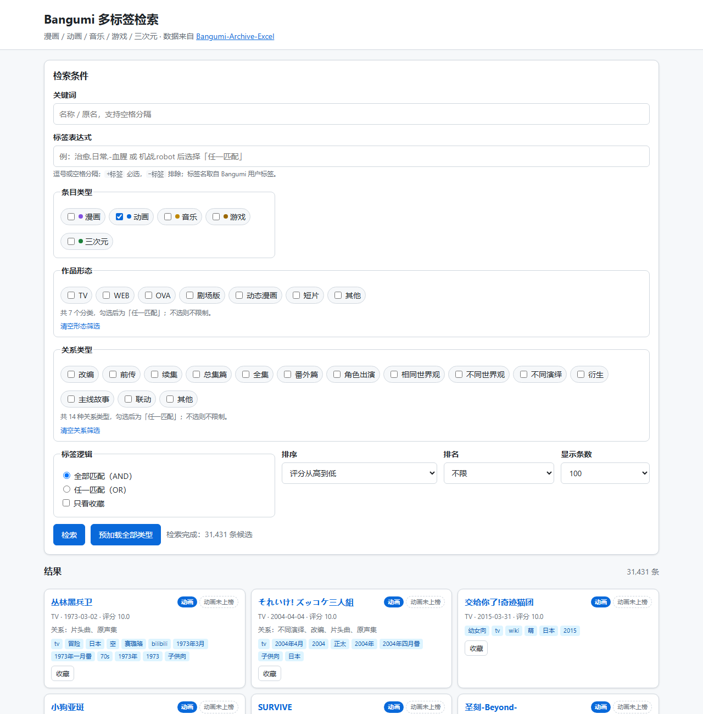

<div align="center">

[](LICENSE)
[](https://developer.mozilla.org/zh-CN/docs/Web/JavaScript)
[](https://awujiana.github.io/Bangumi-Multitag/)
[](https://github.com/awujiana/Bangumi-Archive-Excel)
[](https://github.com/awujiana)
[](https://github.com/awujiana/Bangumi-Multitag)
[](https://github.com/awujiana/Bangumi-Multitag)

<h1>Bangumi 多标签检索</h1>
<h2>Bangumi-Multitag</h2>

<strong>基于每周归档分片、无需 API Token 的 Bangumi 条目多标签检索页面</strong>

</div>

---

> [!WARNING]
> 本项目的相当一部分代码由 AI 辅助生成，并经过持续的人工作业、联调和重构，但它仍然可能存在遗漏、边界情况处理不足或行为与预期不完全一致的问题。如果你在使用过程中发现 Bug、兼容性问题、异常行为或文档缺失，欢迎积极提交 Issue。最好附上复现步骤、日志、截图和系统版本信息，这会非常有帮助。

## 📚 目录

- [项目简介](#-项目简介)
- [核心功能](#-核心功能)
- [界面预览](#-界面预览)
- [快速开始](#-快速开始)
- [使用说明](#-使用说明)
- [加载失败排查](#-加载失败排查)
- [文档](#-文档)
- [反馈建议](#-反馈建议)
- [关联仓库](#-关联仓库)
- [作者联系方式](#-作者联系方式)
- [开源协议](#-开源协议)

## 🚀 项目简介

`Bangumi 多标签检索` 是一个纯静态的 Bangumi 条目检索页面，数据来自每周生成的 [Bangumi-Archive-Excel](https://github.com/awujiana/Bangumi-Archive-Excel) 归档分片，由 **awujiana** 维护。

它要解决的核心问题是：Bangumi 官方检索难以组合多个标签、作品形态、关联关系与排名条件，而调用 API 又需要 Token、受速率限制。本项目把归档数据预处理为 gzip 分片，浏览器按需拉取后在本地完成全部筛选，因此：

- 不需要 API Token，也不经过第三方接口；
- 筛选在浏览器内完成，输入即响应，无服务端成本；
- 无构建步骤，`index.html` + 静态资源即可部署到 GitHub Pages。

站点地址：<https://awujiana.github.io/Bangumi-Multitag/>

它围绕以下目标设计：

- **可用**：标签、形态、关系、排名四类条件可自由组合；
- **轻量**：只下载当前类型的 `base` / `stats` / `relations` 分片；
- **可复核**：数据与代码分离，分片格式与字段在数据仓库有完整文档。

## ✨ 核心功能

- **关键词检索**：按名称 / 原名检索，支持空格分隔的多个关键词（AND）。
- **多标签筛选**：AND / OR 两种逻辑，支持 `+必选` 与 `-排除`，标签匹配为双向包含。
- **条目类型**：漫画 / 动画 / 音乐 / 游戏 / 三次元，可多选。
- **作品形态**：按类型细分 TV / WEB / OVA / 剧场版 / 动态漫画 / 短片、漫画 / 小说 / 画集、日剧 / 电视剧 / 电影 / 综艺等。
- **关系类型**：前传 / 续集 / 联动 / 原声集 / 扩展包等，按条目类型自动切换，多选为任一匹配。
- **排名展示与筛选**：卡片显示「动画排名 #85 / 动画未上榜」，可按有排名、前 N 名、未上榜过滤。
- **排序与收藏**：评分、排名、日期、名称排序；收藏状态保存在浏览器 `localStorage`。
- **加载容错**：GitHub Raw 失败自动回退 jsDelivr，并给出可操作的错误说明。
- **离线优先的测试**：筛选逻辑与 DOM 解耦，Node 内置测试直接复用同一份代码。

## 📷 界面预览



> 截图包含作品形态、关系类型、排名筛选与结果卡片；数据来自真实归档分片。

## 📦 快速开始

<details open>
<summary><strong>方式一：直接访问在线站点</strong></summary>

打开 <https://awujiana.github.io/Bangumi-Multitag/> 即可使用，无需安装。

</details>

<details>
<summary><strong>方式二：本地运行</strong></summary>

```bash
git clone https://github.com/awujiana/Bangumi-Multitag.git
cd Bangumi-Multitag

# 任选一个静态服务器
python -m http.server 8000
# 然后访问 http://localhost:8000/
```

> 不要直接双击 `index.html`：`file://` 下浏览器禁止读取远端分片，页面会提示改用本地服务器。

</details>

<details>
<summary><strong>方式三：运行测试</strong></summary>

需要 Node.js 18+，无第三方依赖：

```bash
node --test     # 或 npm test
```

</details>

## 🧩 使用说明

1. 在「条目类型」勾选一个或多个类型（默认动画）；
2. 「作品形态」「关系类型」会随所选类型自动列出可选项，多选为**任一匹配**，不选则不限制；
3. 输入关键词或标签表达式，选择排序、排名与显示条数；
4. 点击「检索」或直接切换筛选项即可重新查询；「预加载全部类型」会预先拉取五类数据。

### 作品形态

| 条目类型 | 可选形态 |
| --- | --- |
| 动画 | TV / WEB / OVA / 剧场版 / 动态漫画 / 短片 / 其他 |
| 书籍 | 漫画 / 小说 / 画集 / 绘本 / 写真 / 公式书 / 其他 |
| 三次元 | 日剧 / 欧美剧 / 华语剧 / 电视剧 / 电影 / 演出 / 综艺 / 其他 |
| 音乐 | 专辑 / 广播剧 / 音频 / 电台 / 其他 |
| 游戏 | 游戏 / 软件 / 扩展包 / 试玩版 / 桌游 / 其他 |

### 关系类型

关系编码按条目类型各自定义，同一个数字在不同类型下含义不同（例如 `3001` 在音乐中是「原声集」）。完整对照见 [条目类型与关系类型说明](https://github.com/awujiana/Bangumi-Archive-Excel/blob/main/docs/条目类型与关系类型说明.md)。

### 排名

排名是**条目类型内**的排名，因此卡片统一显示为「动画排名 #85」；没有官方排名的条目显示「动画未上榜」，并可通过排名筛选单独查看或排除。

## 🛠 加载失败排查

页面会先请求 GitHub Raw，失败后自动回退到 jsDelivr；两者都失败才报错，并在状态栏列出每个数据源的失败原因。

| 现象 | 原因 | 处理 |
| --- | --- | --- |
| `file://` 下提示禁止读取远端数据 | 直接双击了 `index.html` | 本目录执行 `python -m http.server 8000`，访问 `http://localhost:8000/` |
| `Failed to fetch`（两个源都失败） | 断网、DNS / 代理限制、GitHub 被拦截 | 检查网络或代理后点「检索」重试 |
| `HTTP 404` | 数据未推送或路径变更 | 等数据仓库 Actions 完成，或在数据仓库执行 `git pull` |
| `HTTP 403/429` | 数据源限流 | 稍后重试 |
| 解压失败 | 浏览器过旧 | 使用 Chrome / Edge 80+、Safari 16.4+ 等支持 `DecompressionStream` 的浏览器 |

已知限制：

- 数据为每周归档快照，不是 Bangumi 实时数据；
- 收藏只保存在当前浏览器，不跨设备同步；
- 首次加载某类型需下载该类型分片，网络较慢时请耐心等待。

## 📖 文档

- [API 与分片字段说明](API.md)
- [条目类型、关系类型与平台编码](https://github.com/awujiana/Bangumi-Archive-Excel/blob/main/docs/条目类型与关系类型说明.md)
- [归档数据仓库](https://github.com/awujiana/Bangumi-Archive-Excel)

> 测试见 `tests/` 目录。

## 💬 反馈建议

提交 Issue 时建议附上：

- 浏览器与操作系统版本
- 复现步骤与当前筛选条件
- 状态栏错误文案或控制台日志
- 截图或录屏

## 🔗 关联仓库

- [awujiana/Bangumi-Multitag](https://github.com/awujiana/Bangumi-Multitag) — 本仓库
- [awujiana/Bangumi-Archive-Excel](https://github.com/awujiana/Bangumi-Archive-Excel) — 每周归档数据与 Excel 产物
- [wlm3201/Bangumi-Multitag](https://github.com/wlm3201/Bangumi-Multitag) — 交互思路参考

## 📮 作者联系方式

- **作者**：awujiana
- **GitHub**：[@awujiana](https://github.com/awujiana)
- **邮箱**：bingshanlengtie@qq.com

## 📄 开源协议

本项目基于 **[AGPL-3.0](LICENSE)**（GNU Affero General Public License v3.0）开源。

根据 AGPL-3.0 的要求：任何人使用、修改或分发本项目代码，若以网络服务器形式向用户提供交互服务，必须同样以 AGPL-3.0 公开其完整对应源代码。

版权所有 © awujiana。
